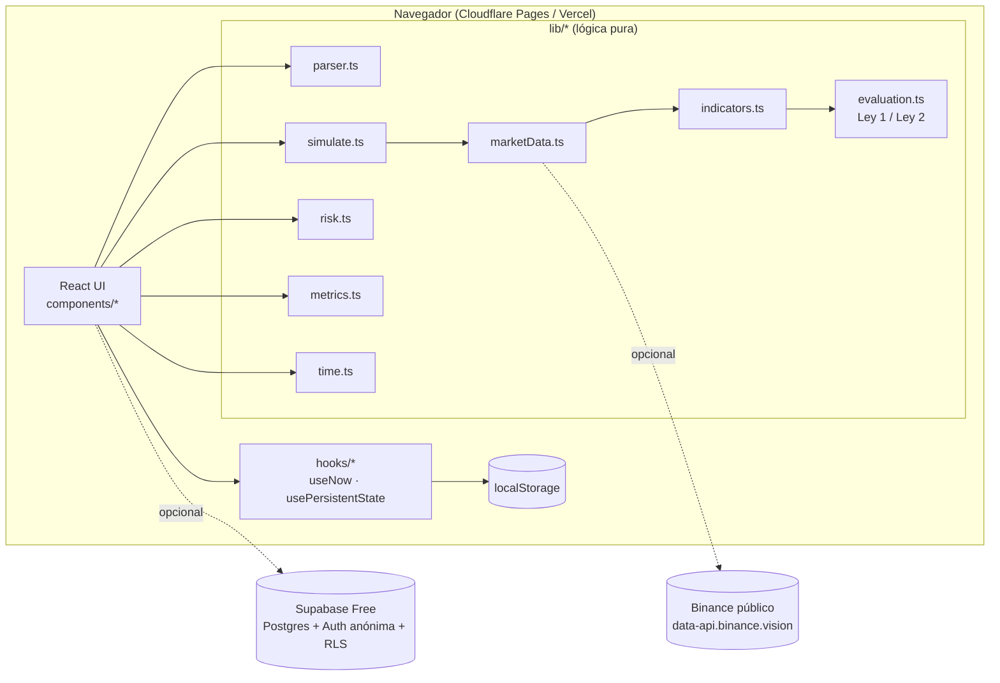
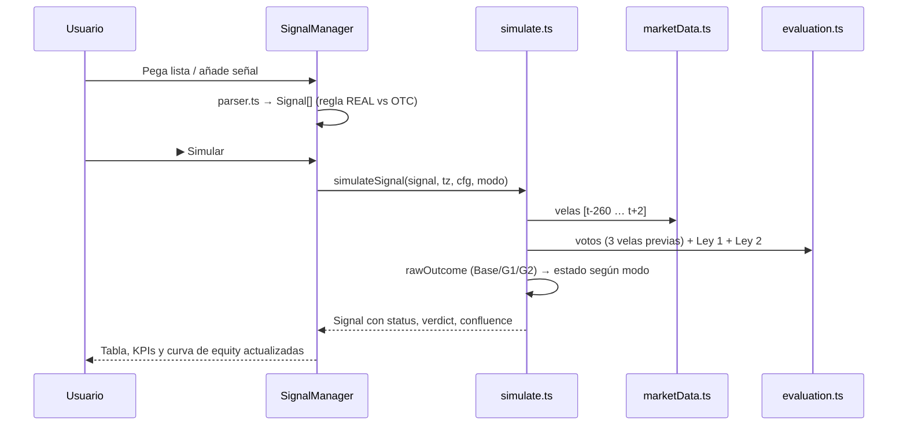

# Arquitectura

## 1. Principios

- **Zero-cost:** sitio 100 % estático; toda la lógica corre en el navegador. Backend opcional (Supabase Free).
- **Local-first:** `localStorage` es la fuente de verdad; la nube es sincronización manual (Guardar / Cargar).
- **Lógica pura separada de la UI:** `src/lib/*` no importa React → testeable con Vitest y reutilizable en un backend (Edge Function / Worker) sin cambios.
- **Determinismo:** el mock de mercado es función pura del tiempo y del activo; la misma vela siempre tiene el mismo OHLC, lo que hace reproducibles las simulaciones.
- **Sin ejecución financiera:** no existen integraciones con brokers ni endpoints de órdenes.

## 2. Vista de capas



## 3. Flujo de una señal



## 4. Modelo de datos

```ts
interface Signal {
  id: string; date: 'YYYY-MM-DD'; time: 'HH:MM';      // hora en la zona de la lista (UTC-3)
  asset: 'EUR/AUD'; market: 'REAL' | 'OTC'; expiry: 'M1' | 'M5'; direction: 'CALL' | 'PUT';
  status: 'Pendiente' | 'Ganada Base' | 'Ganada Gale 1' | 'Ganada Gale 2' | 'Perdida' | 'Omitida';
  rawOutcome?: ...; verdict?: 'APROBADA' | 'REVISAR' | 'DESCARTADA'; confluence?: 0..5;
}
```

`localStorage` keys: `botz.signals.v1`, `botz.settings.v1`, `botz.simlog.v1`.

## 5. Zonas horarias

Sin librerías: `Intl.DateTimeFormat` calcula el offset de cualquier zona IANA (`time.ts`). Brasil no aplica horario de verano desde 2019, así que `America/Sao_Paulo` = UTC-3 fijo; Bolivia = UTC-4 fijo. `lightweight-charts` trabaja en UTC, por eso las velas se desplazan por el offset de la zona de visualización.

## 6. Extender con otros proveedores de datos

Implementa una rama nueva en `fetchCandles()` (`src/lib/marketData.ts`) que devuelva `Candle[]` (epoch en segundos). Opciones con capa gratuita y API key (guárdala en una Cloudflare Pages Function / Vercel Function, **nunca** en el bundle del cliente):

| Proveedor | Cobertura | Nota |
|---|---|---|
| Twelve Data | Forex, cripto, acciones | Plan gratuito con límite diario |
| Alpha Vantage | Forex intradía | Plan gratuito con límite por minuto/día |
| Finnhub | Forex/cripto | Plan gratuito |

Verifica los límites vigentes en la web de cada proveedor antes de integrarlos.

## 7. Seguridad

- `public/_headers` y `vercel.json` aplican `X-Frame-Options`, `nosniff`, `Referrer-Policy`.
- La `anon key` de Supabase es pública por diseño; la protección real son las políticas **RLS** (`owner = auth.uid()`).
- No hay `dangerouslySetInnerHTML`; todo texto de usuario se renderiza escapado por React.
- El parser solo acepta patrones conocidos (hora, activo, dirección, expiración).
