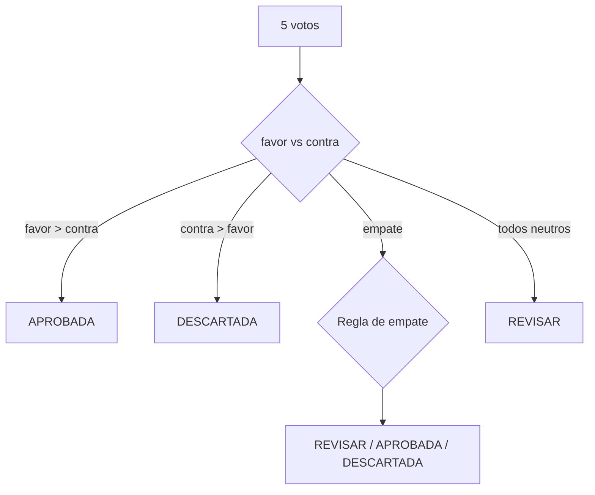

# Indicadores, Ley 1, Ley 2 y ciclos

Este documento describe **exactamente** lo que implementa el código (`src/lib/indicators.ts`, `src/lib/evaluation.ts`, `src/lib/risk.ts`, `src/lib/simulate.ts`). Todas las reglas son configurables desde el panel *Configuración*.

> Las reglas de voto son una interpretación técnica estándar de cada indicador, adaptada a la dinámica "3 velas previas". No representan una estrategia validada.

---

## 1. Ventana de análisis

```text
 ... ─┬────┬────┬────┬────────────┬────────┬────────┐
      │ v1 │ v2 │ v3 │  OBJETIVO  │ Gale 1 │ Gale 2 │
 ... ─┴────┴────┴────┴────────────┴────────┴────────┘
        ▲ 3 velas CERRADAS        ▲ entrada  ▲ ciclos (solo para resolver el resultado)
```

- **Vela objetivo** = la vela que empieza a la hora de la señal (M1 = 60 s, M5 = 300 s).
- Se evalúan las `lookback = 3` velas **cerradas** inmediatamente anteriores.
- Nunca se usa información posterior a la vela objetivo para votar (sin *look-ahead*). Las velas de Gale solo se usan para **resolver** el resultado.
- Se cargan 260 velas de historia para que la EMA 100 esté estabilizada.

---

## 2. Indicadores y regla de voto

| Indicador | Cálculo | Voto CALL | Voto PUT | Neutro |
|---|---|---|---|---|
| **EMA 100** | EMA clásica, `k = 2/(n+1)`, semilla = SMA(n) | 3/3 cierres **sobre** la EMA (tendencia alcista) | 3/3 cierres **bajo** la EMA | Precio cruzando la EMA |
| **Fractals 6P** | Fractal de Bill Williams con `half = ceil((P-1)/2)` velas a cada lado (P=6 → 3, P=5 → 2 clásico) | Último fractal **inferior** confirmado (soporte) | Último fractal **superior** confirmado (resistencia) | Sin fractal reciente o fractal doble |
| **Bollinger 20,2** | SMA(20) ± 2·σ (σ poblacional) | Alguna de las 3 velas toca/rompe la banda **inferior** (reversión) | Toca/rompe la banda **superior** | Dentro de bandas o toques en ambas |
| **RSI 6 [80/20]** | RSI de Wilder | Algún valor ≤ 20 (sobreventa) | Algún valor ≥ 80 (sobrecompra) | Zona media o extremos opuestos |
| **Stochastic K=6 [80/20]** | %K lento = SMA₃(%K bruto 6); %D = SMA₃(%K) | Algún %K ≤ 20 | Algún %K ≥ 80 | Zona media o extremos opuestos |

### Fórmulas

$$EMA_t = P_t \cdot k + EMA_{t-1}(1-k),\quad k=\frac{2}{n+1}$$

$$BB = SMA_{20} \pm 2\sigma_{20}$$

$$RSI = 100 - \frac{100}{1 + \frac{\overline{G}}{\overline{L}}}\quad(\text{medias de Wilder})$$

$$\%K_{bruto} = 100\cdot\frac{C_t - LL_6}{HH_6 - LL_6}$$

### Nota sobre fractales

Un fractal en la vela *i* solo existe cuando ya cerraron `half` velas a su derecha. Por eso el motor busca el **último fractal confirmado** cuyo índice sea `≤ t − 1 − half`, dentro de una ventana de `lookback + 2·half` velas. El gráfico solo muestra fractales anteriores a la vela objetivo.

---

## 3. Ley 1 · Dirección por mayoría

Sea `favor` = votos en la dirección de la señal y `contra` = votos en la dirección opuesta.

| Condición | Veredicto |
|---|---|
| `favor > contra` | **APROBADA** |
| `contra > favor` | **DESCARTADA** |
| `favor == contra > 0` (empate técnico) | Configurable: `REVISAR` (defecto), `APROBADA` o `DESCARTADA` |
| Todos neutros | **REVISAR** |



## 4. Ley 2 · Confluencia y límite de ciclos

`confluencia = favor` (0 si la señal fue descartada).

| Confluencia | Nivel |
|---|---|
| 0 | Sin confluencia |
| 1 | Riesgo **Alto** |
| 2 | Riesgo **Moderado** |
| 3–5 | Riesgo **Bajo relativo** |

**Límite de ciclos por modo:**

| Modo | Señales operadas | Ciclos máximos |
|---|---|---|
| `Copia sin filtro` | Todas | Base + Gale 1 + Gale 2 |
| `Con filtro de indicadores` | Solo `APROBADA` (y `REVISAR` si se activa la opción) | Base + **Gale 1** |

Nunca se escala a Gale 3 o superior.

---

## 5. Resolución de resultados (simulador)

1. Se obtiene el resultado "de mercado" (`rawOutcome`): la vela objetivo gana si cierra a favor (`CALL: close > open`, `PUT: close < open`); si no, se prueba Gale 1 (vela siguiente) y luego Gale 2. Doji = pérdida.
2. Se aplica el modo:
   - Modo filtro + `DESCARTADA` (o `REVISAR` sin la opción activa) → **Omitida** (filtrada).
   - Si el nivel ganador supera el máximo del modo → **Perdida**.
3. La métrica *"habrían perdido"* compara las omitidas con su `rawOutcome` para medir el efecto del filtro.

## 6. Ciclos y riesgo

Con monto base $B$, multiplicador $m$ y payout $p$:

$$A_L = B\cdot m^{L},\qquad Exp_L = \sum_{j=0}^{L} A_j,\qquad Neto_L = A_L\cdot p - Exp_{L-1}$$

Ejemplo $B=10,\ m=2.2,\ p=0.85$:

| Ciclo | Monto | Exposición | Neto si gana |
|---|---|---|---|
| Base | 10.00 | 10.00 | +8.50 |
| Gale 1 | 22.00 | 32.00 | +8.70 |
| Gale 2 | 48.40 | 80.40 | +9.14 |

**Break-even por entrada:** $q^* = \frac{1}{1+p}$ → con 85 % de payout, ≈ **54.05 %**.

**Valor esperado de un ciclo** con probabilidad de acierto por entrada $q$ y $G$ = gale máximo:

$$EV = \sum_{L=0}^{G} (1-q)^L q\cdot Neto_L \; - \; (1-q)^{G+1}\cdot Exp_G$$

Con $q = 0.5$ y payout 85 % el EV es negativo tanto con G1 como con G2: el ciclo convierte muchas ganancias pequeñas en pérdidas grandes y poco frecuentes. Por eso la calculadora muestra la pérdida máxima por ciclo como % del capital y alerta por encima del 10 %.
